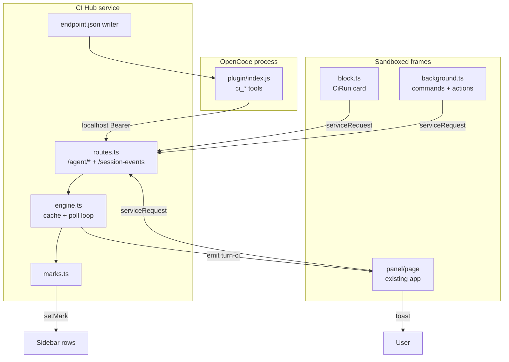

# CI Hub: extension surfaces beyond the panel — design

Date: 2026-11-20. Status: draft, awaiting the user's approval.
Repo: `openchamber-ci-hub` (branch `master`, version 0.2.0, SDK `@openchamber/sdk` 2.7.1).

## Intent and why

Today CI Hub is visible only inside its own panel/page and Work Status section.
The user wants CI to show up where the work already happens: on sidebar rows,
inside agent replies, and in the agent's own hands. Ten capabilities were picked
from the SDK catalog; the rest were explicitly dropped.

The point is not more UI. It is: a failed run finds the user, and the agent can
read and act on CI without a copy-pasted `@` mention.

## Decisions made by the user

- Feature set (10): sidebar marks, `CiRun` chat block, agent tools
  (`opencodePlugin`), tool-call cards (`contributes.tools`), `sessionEvents`,
  `host.generate` failure summary, instructions + skill, slash commands and
  actions, `openCommit(sha)` reuse, mobile opt-in.
- Agent tools reach CI data **through the existing service**, discovered via an
  endpoint file — not through `gh`/`glab` in the plugin.
- After an agent turn ends with a failed CI on its branch: **update the mark and
  show a toast when a CI Hub frame is open**. Nothing is written into the chat.
- Dropped: external notification channels (Telegram/webhook), claiming run URLs
  in chat (`contributes.links`), cron-scheduled polling, toast/badge as a
  standalone feature.
- Marks stay fresh through **background polling at a slower cadence**: when no
  CI Hub frame and no Work Status section is open, the engine polls every 60 s
  instead of stopping, and uses its normal interval while something is open.
- **One local OpenChamber backend per machine** is an explicit assumption; the
  plugin validates the endpoint file against `/health` and reports a stale or
  foreign endpoint as a plain error.
- Marks and toasts get **on/off switches drawn by the panel itself** as segmented
  buttons (the integration settings schema has no boolean type). Preferences are
  stored by the service, so every frame and the service agree.
- **Everything ships in a single version** (0.3.0); the stages below are an
  implementation order, not separate releases.

## Goals

1. A session/worktree/folder row in the sidebar shows the CI state of its branch.
2. An agent can render a live run card in its reply with one component call.
3. An agent can list runs, read a failing log and re-run without leaving OpenCode.
4. A failing log can be summarized by the host's Small Model on demand.
5. The agent learns how to do all this from the extension itself.

## Non-goals

- No OS/push notifications, no external delivery channels.
- No new CI providers, no changes to provider semantics or token handling.
- No chat messages posted by the service on its own.
- No discovery or routing for several concurrently running OpenChamber backends.

## Anti-goals

- Tokens leaving the service process (the plugin gets only a localhost port and
  the per-process service token, exactly what a frame already uses).
- Agent context bloat: one chat block, four tools, capped payloads.
- Extra polling: marks and session events reuse the existing poll loop and cache.
- The chat block must not load the 133 KB panel bundle.

## Constraints (verified against the installed SDK schemas and docs)

- Frames talk to the service only through `host.serviceRequest`; the service
  listens on `127.0.0.1:$OPENCHAMBER_SERVICE_PORT` and requires
  `Authorization: Bearer $OPENCHAMBER_SERVICE_TOKEN`.
- `contributes.marks: true` needs `service`; `setMark(target, mark)` is called
  by the service host. Marks die with the process, so `service.keepRunning: true`
  is required. Limits: 200 marks, 60 changes/minute. Targets: `{sessionId}`,
  `{directory, branch}`, `{directory}`.
- `contributes.blocks`: 1–4 entries; `name` PascalCase; `description`;
  **`args` is an array of camelCase name strings**, not objects; `entry` is a
  package-local `.html`; optional `height` (24..max); `answers: true` enables
  `host.answerBlock(text)` from a click. Args are untrusted input.
- `contributes.opencodePlugin`: a folder whose entry default-exports
  `{ id, setup }`, loaded with a bare `import()` from a folder with nothing
  installed — **no package imports**. Tools take `input` as plain JSON Schema and
  answer `{ content }`.
- `contributes.tools`: presentation only, no code. `match` is the exact tool name
  or one trailing `*`; `output: "card"` draws from the tool's JSON output with
  `{output.path}` templates; `fields` ≤ 8; `status.tones` ≤ 16 exact strings.
- `contributes.background.entry`: a hidden frame for background actions and slash
  commands. **When both panel and background entries exist, only the background
  frame registers `onResolve`.** 20-second deadline per invocation.
- `contributes.sessionEvents`: `{ events: [...] }`; the host POSTs to
  `/session-events`; parse with `readSessionEventRequest`, answer `{ ok }`.
  `content: true` is **not** set — we need identifiers, not transcripts, so the
  `transcript` capability is never requested.
- `host.generate` needs `capabilities: [..., "model"]`; late answers arrive via
  `onLateGenerateResult`; `NO_MODEL` is a normal outcome.
- `contributes.instructions: true` enables service `setInstructions(directory|null, text)`
  (≤ 4096 chars). `contributes.skills` names a folder.
- `contributes.integration.settings` entries are only `{ id, label, secret? }` —
  there is no boolean/select field type.
- Mobile: `panel.mobile: true` and page `mobile: true`; blocks, marks, Work
  Status sections, slash commands and background actions need no opt-in.

## Approaches considered

**A. Service stays the single data source; thin separate frames; endpoint file
for the plugin (chosen).** The service writes `endpoint.json` on listen; the
OpenCode plugin reads it and calls the same localhost HTTP API the frames use.
The chat block and the background frame get their own small bundles that reuse
`src/ui/port.ts` and the domain helpers. One code path for all six providers,
tokens never leave the service.

**B. One bundle for every surface.** `panel/main.js` branches on `ctx.surface`
and also draws the block and background frame. Fewer files, but every run card in
chat would pay for the whole panel (133 KB JS plus all CSS), and the panel's
state machine would grow surface special cases. Rejected.

**C. Plugin talks to `gh`/`glab` directly.** No endpoint file, no new routes —
but only GitHub/GitLab, no Gitea/Forgejo/Woodpecker/Bitbucket, and it bypasses
the accounts OpenChamber already holds. Rejected.

## Architecture

## Parts

### 1. Service keep-alive and the endpoint file (stage 3, but designed here)

- Manifest: `service.keepRunning: true` (stage 1, marks need it).
- New `src/service/endpoint.ts`: `writeEndpoint(file, {port, token, pid, startedAt})`
  with mode `0600`, `removeEndpoint(file)`.
- `service/main.ts` writes it in the `server.listen` callback and removes it on
  shutdown. The file always lives at `~/.openchamber-ci-hub/endpoint.json`, even
  when `OPENCHAMBER_SERVICE_DATA_DIR` points elsewhere, so the plugin has one
  stable place to look.
- Contents: `{ port, token, pid, startedAt, version }`. The token is the same
  per-process token frames already use; nothing new is exposed beyond localhost.
- The plugin checks `GET /health` before trusting the file and treats a stale or
  foreign endpoint as "CI Hub service is not reachable". Only one backend per
  machine is supported; a second instance overwrites the file.

### 2. Sidebar marks (stage 1)

- Manifest: `contributes.marks: true`, `service.keepRunning: true`.
- New `src/service/marks.ts`, pure and unit-tested:
  `computeMarks(watch: {directory, branch, runs}[]) → Map<targetKey, mark|null>`
  and a differ that emits only changes and respects the 60/minute budget.
- Engine gains an optional dep `setMark(target, mark)` so tests fake it.
  `service/main.ts` wires it to `host.setMark`.
- Watch set: every enabled repo with a `directory` in the config, plus
  directories seen in session events (so a worktree session is covered).
  Branch comes from the existing `repoForDirectory`/`detect` cache.
- Mark content: failed → `error` tone, `CI failed · <workflow> #<number>`;
  in progress → `info` tone; anything else clears the mark. One mark per row,
  the most recent run on that branch decides.
- After every `pollAll` the marks are recomputed from the cache; no extra CI
  requests are made for marks.
- The engine's watch rule changes: `keepRunning` plus marks means polling no
  longer stops when nothing is open. While a panel/page or the Work Status
  section is open the existing interval applies; otherwise the engine polls every
  60 s. Session events still trigger an immediate single-repo refresh on top of
  that cadence.

### 3. Session events → mark + toast (stage 1)

- Manifest: `sessionEvents: { events: ["turn-finished", "turn-failed"] }`.
- `routes.ts`: `POST /session-events` → `engine.sessionEvent(event)` → `{ ok: true }`.
- Engine: resolve the event's project directory to a repo + branch, refresh that
  one repo with the existing `pollRepo`, recompute marks, and emit
  `emit("turn-ci", { directory, repo, branch, runId, conclusion, failingJobs })`
  when the branch's latest run is failing. Dedupe per `runId:attempt` so a poll
  does not re-toast the same failure.
- `src/ui/app.ts` already subscribes with `host.onServiceEvent`; add a `turn-ci`
  branch that calls the existing `toast()` helper. If no CI Hub frame is open,
  nothing is shown — that is the accepted behavior.

### 4. `CiRun` chat block (stage 2)

- Manifest: one block only (each block's signature costs context in every session):
  `{ name: "CiRun", description, args: ["repo", "runId"], entry: "panel/block.html", answers: true }`.
- New `src/ui/block.ts` → `panel/block.js`, plus `panel/block.html`. Reuses
  `createSvc`, `src/domain/format.ts`, `src/domain/handoff.ts` and its own small
  CSS built on the same theme variables. It does not import the panel app.
- On `host.onBlock`: validate `repo`/`runId`, `GET /run`, render workflow, run
  number, branch, status/conclusion, duration, failing jobs; `host.setHeight`.
- Buttons (all side effects behind a click): re-run failed (`POST /action`),
  show/hide the failing log excerpt (`GET /log`), the sha opens the diff with
  `host.openCommit(sha)`, and "Fix with the agent" answers the block with the
  existing `buildHandoff` text so panel and block produce identical hand-offs.

### 5. Agent tools (stage 3)

- New routes, same auth, deliberately small payloads so the panel's larger views
  never land in the agent's context:
  - `GET /agent/runs?directory|repo&branch&limit` → `{ items: [...] }`, ≤ 20.
  - `GET /agent/run?repo&runId` → run + jobs with failing steps.
  - `GET /agent/log?repo&runId&jobId` → the existing `errorExcerpt`, capped.
  - Re-runs reuse the existing `POST /action`.
- New `plugin/index.js` (no package imports): `{ id: "ci-hub", setup }` exposing
  four tools, each `{ description, input: <JSON Schema>, execute }` answering
  `{ content: [{ type: "text", text }] }` with compact JSON text:
  `ci_list_runs`, `ci_run_detail`, `ci_failing_log`, `ci_rerun`.
- The plugin reads the endpoint file (Node builtins through dynamic `import()`),
  calls with `fetch` + Bearer + a 15 s timeout, and returns a readable message
  when the service is down instead of throwing.
- Out of scope for the tools: cancel, dispatch, approve.

### 6. Tool-call cards (stage 3)

- `contributes.tools`: `ci_run_detail` and `ci_rerun` as `output: "card"`
  (status tones success/failure/cancelled/running), `ci_list_runs` as a card
  list over `output.items`, `ci_failing_log` as `output: "code"`.
- Depends on how the host reads a plugin tool's `{ content }` text as JSON
  output; verified in the stage-3 spike, with `output: "json"` as the fallback.

### 7. "Why it failed" summary (stage 2)

- Manifest: `capabilities` gains `"model"`.
- `src/ui/app/log.ts`: a "Why it failed" button on a failed run sends
  `host.generate({ system, prompt, maxOutputTokens: 400 })` with the existing
  `errorExcerpt` as the material, renders the answer above the log, and caches it
  per `repo#runId:attempt` in `host.storage`.
- `onLateGenerateResult` is handled so a closed/reopened panel still gets the
  answer; `NO_MODEL` becomes a plain toast.

### 8. Instructions and skill (stage 3)

- Manifest: `instructions: true`, `skills: "skills"`.
- On start the service calls `setInstructions(null, text)`: use the `ci_*` tools
  for CI questions, show a finished run with `CiRun("repo", "runId")`, never
  invent run ids, repo keys look like `github:host/owner/name`.
- `skills/ci-hub/SKILL.md`: the triage workflow (list → detail → failing log →
  fix → re-run → show the `CiRun` block).

### 9. Slash commands, actions, background frame (stage 3)

- Manifest: `background: { entry: "panel/background.html" }`,
  `commands: [{name: "ci-status"}, {name: "ci-fix"}]`, one session action
  `{ id: "ci-check", where: "session", mode: "background", label: "Check CI" }`.
- New `src/ui/background.ts` → `panel/background.js`: `onResolve` turns
  `/ci-status` and `/ci-fix` into composer chips whose `text` is a compact run
  summary; `onAction` refreshes the session's repo and toasts the result.
- Because the background entry owns `onResolve`, no command handling is added to
  the panel.

### 10. `openCommit` reuse (stage 2)

Already in `src/ui/app/detail.ts`. The block's sha button uses it too. No other
surfaces change.

### 11. Mobile opt-in (stage 1)

`panel.mobile: true` and page `mobile: true`; then a pass at 360 px width (the
app already switches to a narrow layout) and at the user's 1080×1920 portrait
monitor, fixing only what actually breaks.

### 12. Preferences UI for marks and toasts

- Service-side preferences, persisted next to the existing config in the data
  dir: `{ marks: boolean, toastOnTurnFailure: boolean }`, both default `true`.
- New routes `GET /prefs` and `PUT /prefs`; the engine reads them before setting
  marks and before emitting `turn-ci`.
- The panel header gets a compact settings popover with two segmented
  on/off controls ("Sidebar marks", "Toast when CI fails after a turn"), built
  from the existing button styles. Turning marks off clears the marks we set.

## My calls (not the user's)

- Marks show failure and in-progress only; green clears the mark.
- Both preferences default to on; the panel writes them through the service, not
  through `host.storage`, because the service owns the behavior.
- One chat block, four agent tools, one session action.
- Global instructions (`setInstructions(null, …)`), not per-directory.
- Endpoint file at the fixed `~/.openchamber-ci-hub` path regardless of the data
  dir override.
- Tool text answers are compact JSON, so both the model and the card
  presentation can read them.

## Rollout

One release, **0.3.0**, on one feature branch, ending with `bun run check` green.
No push or PR without being asked. The work is built and verified in this order
so that each stage leaves the extension usable:

1. **Visibility:** keepRunning, background cadence, marks, session events +
   toast, preferences UI, mobile.
2. **Chat:** `CiRun` block, `openCommit` in the block, generate summary.
3. **Agent:** endpoint file, `/agent/*` routes, plugin, tool cards,
   instructions + skill, commands/actions + background frame.

## Testing

- Unit (bun, existing style): marks computation + diff/budget, watch cadence
  switching between open and idle, endpoint write/remove, session-event handling
  and toast dedupe, preferences read/write and their effect on marks and emits,
  `/agent/*` payload caps, block argument validation,
  hand-off text shared by panel and block.
- `bun run typecheck`, `bun test`, `bun run build`, `bunx openchamber-guest-check`.
- Live spike per phase for what unit tests cannot see: marks on real sidebar
  rows, a real `CiRun` block, plugin loading in OpenCode, tool cards in chat,
  slash command resolution through the background frame.

## Left to the builder

- Whether the plugin entry may dynamically import `node:fs/promises` / `node:os`
  (the docs forbid package imports; builtins are expected to work — verify first).
- Whether `contributes.tools` cards read JSON carried in a tool's text `content`.
- Exact `skills` folder layout the host expects.
- The chip `providerId` value `onResolve` should return for this extension.
